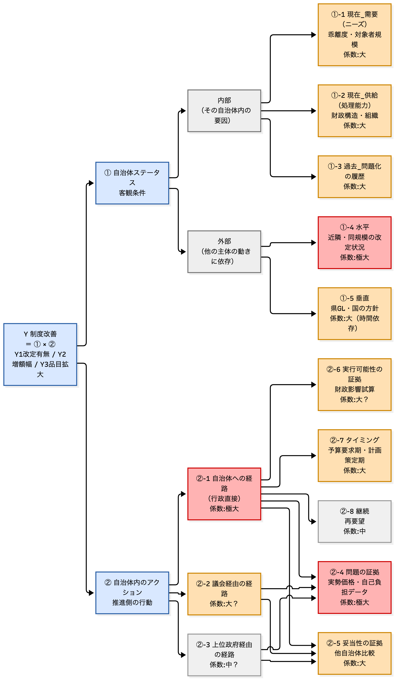

- ゴールについて
	- 10自治体へのインタビューと、ご要望のある変数を追加したDBの作成があると思います
	- いただいた資料も踏まえて、最終的なゴールは以下と認識をしました。
		1. どんなデータや情報が増額するきっかけになるか？を特定し、他の市町村分も用意し「勝ちパターン」をこちらよりご提案。コロプラ様においても、同様に増額もしくは範囲内拡大を目指せる状態になること。（インタビューと、DB作成）
		2. それに加えて、今回訪問する自治体が、来年度に基準額を増額する（もしくは基準範囲を広げる）ための予算を確保し、再来年度に増額をすること
			- なお、来年度予算はちょうどこの時期に締め切られてきているはずのため、来年度の増額は難易度が高いものと思っています。

- 納品物イメージ
	1. 今回訪問する10自治体について、「どういうデータをもとに、どういうコミュニケーションをとったか」「どういう情報があれば当該市町村が増額に動けそうか（現状増額に動けていない理由）」をまとめ、来年度に向けてコロプラ様もしくはJOA様による継続フォローを行うための素材を用意する。（増額のきっかけを作る）
		- 形態：パワーポイント
			- 自治体A：ステータスはxxであり、こういう仮説をもとに、こういうインタビューを行った。アプローチ先はxx課。使ったDBの中の変数はこれで、結果こういうことが情報を入手できた。今後はこの時期に、こういうアプローチを行うことで、基準額の増額を見込める。（メモ：ここに①自治体ステータス×②アクション という方程式が組み込まれるイメージ。）
	2. 働きかけるべき自治体ターゲットを絞るため、また自治体へのアプローチ（要望書に含めるとよい情報・自治体への説明に使うとよい情報）についてまとめたデータベースを作成し、データベース更新方法や出典情報についてもまとめる。
		- 形態：エクセル
		- ※PPTX資料等で、今回のターゲット以外の自治体についても、①自治体ステータス×②アクション という方程式により、bynameで次のターゲットとアクション提案ができると尚よしか。
		- 以下イメージを、お打ち合わせで簡単にお示しし、まずはこういう感じで整理して、どの変数がクリティカルなのか、を探っていく形でDBも考えるし、インタビューでも情報収集をしていきますね、みたいな感じでか。

- スケジュール
	- 〜11月中旬：アポ取り、DB仮説構築、訪問準備
	- 11月下旬〜12月初旬：ターゲット自治体訪問
	- 1月中：コロプラ様へ納品物素案をご提示、ご意見いただく
	- 2月中：ご意見をもとに修正
	- 3月中：報告書ご納品

- 確認したい事項
	- 今回候補に挙がっている10自治体へ送付した要望書をいただけないか
	  （JOA様へもお伺いはしてみようと思っています）
	- 自治体へのアポの取得方法について。
	  すでにコロプラさんの方で関係のある市町村、担当者の場合は、皆様よりとっていただくのが良いか、それとも担当者を指定いただきこちらよりアポ取りがよいか？もしくはゼロベースでこちらからアポ取りがよいか？（関係性次第で）
	- オストメイトの理解促進や、勉強会の資料をいただきたい。
	  この内容をネタに（プレゼントに）、ご訪問をさせていただくのはどうか？と思っています。※「インタビューさせてほしい」よりも「情報提供と共に、インタビューも」の方がアポが取りやすいかなと
