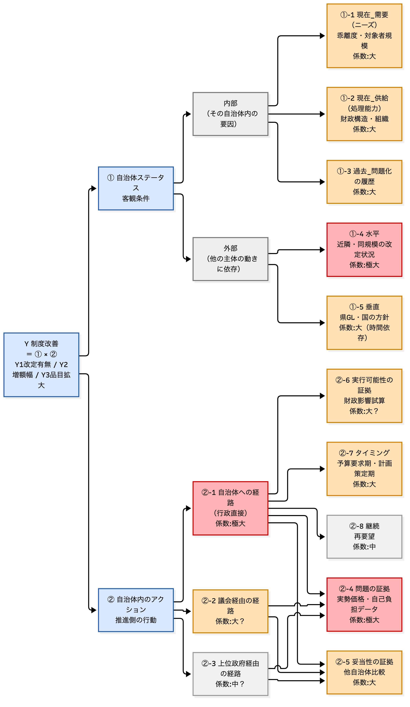

- ゴール（わたしたちチーム内での共通認識的な）
	- コロプラ様のニーズを理解する
	- 期待値に沿う納品物イメージ（少なくともその方向性）を合意する
	- スケジュールについて合意をする

- コロプラ様のニーズ
	- （おそらく先方も用意がありそうなので、まずそれをお伺いする）
	- 10自治体へのインタビューと、ご要望のある変数を追加したDBの作成があると思います
	- いただいた資料も踏まえて、最終的なゴールは以下と認識をしました。
		1. どんなデータや情報が増額するきっかけになるか？を特定し、他の市町村分も用意し「勝ちパターン」をこちらよりご提案。コロプラ様においても、同様に増額もしくは範囲内拡大を目指せる状態になること。（インタビューと、DB作成）
		2. それに加えて、今回訪問する自治体が、来年度に基準額を増額する（もしくは基準範囲を広げる）ための予算を確保し、再来年度に増額をすること
			- なお、来年度予算はちょうどこの時期に締め切られてきているはずのため、来年度の増額は難易度が高いものと思っています。

- 納品物イメージ
	1. 今回訪問する10自治体について、「どういうデータをもとに、どういうコミュニケーションをとったか」「どういう情報があれば当該市町村が増額に動けそうか（現状増額に動けていない理由）」をまとめ、来年度に向けてコロプラ様もしくはJOA様による継続フォローを行うための素材を用意する。（増額のきっかけを作る）
		- 形態：パワーポイント
			- 自治体A：ステータスはxxであり、こういう仮説をもとに、こういうインタビューを行った。アプローチ先はxx課。使ったDBの中の変数はこれで、結果こういうことが情報を入手できた。今後はこの時期に、こういうアプローチを行うことで、基準額の増額を見込める。（メモ：ここに①自治体ステータス×②アクション という方程式が組み込まれるイメージ。）
	2. 働きかけるべき自治体ターゲットを絞るため、また自治体へのアプローチ（要望書に含めるとよい情報・自治体への説明に使うとよい情報）についてまとめたデータベースを作成し、データベース更新方法や出典情報についてもまとめる。
		- 形態：エクセル
		- ※PPTX資料等で、今回のターゲット以外の自治体についても、①自治体ステータス×②アクション という方程式により、bynameで次のターゲットとアクション提案ができると尚よしか。
		- 以下イメージを、お打ち合わせで簡単にお示しし、まずはこういう感じで整理して、どの変数がクリティカルなのか、を探っていく形でDBも考えるし、インタビューでも情報収集をしていきますね、みたいな感じでか。

- スケジュール
	- 〜11月中旬：アポ取り、DB仮説構築、訪問準備
	- 11月下旬〜12月初旬：ターゲット自治体訪問
	- 1月中：コロプラ様へ納品物素案をご提示、ご意見いただく
	- 2月中：ご意見をもとに修正
	- 3月中：報告書ご納品

- 確認したい事項
	- 今回候補に挙がっている10自治体へ送付した要望書をいただけないか（JOA様へもお伺いはしてみようと思っています）
	- 自治体へのアポの取得方法について。すでにコロプラさんの方で関係のある市町村、担当者の場合は、皆様よりとっていただくのが良いか、それとも担当者を指定いただきこちらよりアポ取りがよいか？もしくはゼロベースでこちらからアポ取りがよいか？（関係性次第で）
	- オストメイトの理解促進や、勉強会の資料をいただきたい。この内容をネタに（プレゼントに）、ご訪問をさせていただくのはどうか？と思っています。※「インタビューさせてほしい」よりも「情報提供と共に、インタビューも」の方がアポが取りやすいかなと

-----以下は一度チームでイメージの共有がしたい。コロプラさんにはお見せしない前提で、具体を想像してみたというメモ。------

- **アポからインタビューまでの具体イメージをしてみる**
	1. 方法を決める（誰が？(コロプラさん or 私たち)・媒体は？(電話 or メール)）
		- おそらくメールしてから電話、がよいか。自治体に対するテレアポ獲得率は低くないが、ここで断られると痛いため、慎重にいきたい。コロプラさん関係性あれば、コロプラさんからの方が取得可能性が高いか。
	2. アポを取る
		- 以下のイメージか。
		- 「お世話になっております。コロプラストのxxと申します。今ですね、全国の自治体様に、"日常生活用具給付等事業"の基準額の決め方、について調査を進めておりまして、ちょっとその件でご連絡をさせていただきました。皆様の事業運営の一助となるよう、ぜひ情報提供と合わせて、皆様のご状況をお伺いできたらと思っております。よろしければご訪問の上、お話お伺いできないでしょうか？なお当日は、当社と共に調査を行っております、シビックリンク法務経営政策研究所というところのものもお伺いさせていただきます。日程についてですが・・・（日程調整へ進む）」
		- **と、イメージをすると、何かしら先方にもプレゼントというか、情報は持っていく流れにした方が、アポ獲得率が上がる気がする。（が、ここはコロプラさんの感覚値も伺いたいと思っています。「まあアポは行けると思いますよ」だったらあまり気にしすぎなくて良さそう）ここで、上記確認事項にも書いたオストメイトの理解促進資料、勉強会資料を使いたい**
	3. 訪問する
		- まずは、情報提供を行う
			- まずは一般的な話を。オストメイトの理解促進、勉強会資料を用いて簡単に。
			- その後に当該市町村のデータを用いて説明（ここでDBに入る変数候補を用いる。貴庁ではこんなにオストメイトの人がいますよ、とか自己負担額こんなに上がってるんですよねとか、近隣自治体はこういう理由でこれくらい増額をされています、とか。増額することによる自治体のメリットも述べたい。）
		- その中で半構造化的なインタビューをする
		  ※ここはまだ吟味できていない。が、おそらくはJOAからの要望書がスタートになることはまず間違いなさそうだと新留的にはみています。ので、要望書提出→基準額or範囲改訂までのファネルをイメージし、そのファネルのどこで止まったのか、なぜ止まったのか。どういう情報やデータがあれば次のステップに進めたのか、をインタビューするイメージを持っています。
		
		  インタビューは「基準額改定までの標準プロセスのどこで止まっているか」を特定する設計。
		  標準プロセス＝①要望 or 議会質問（入力経路）→②担当課での検討着手→③比較・財政影響の検討→④要綱改正・財政課協議→⑤予算要求とのタイミング整合→⑥決裁・施行。
			- 0. 起点質問：「最後に基準額を改定した、あるいは改定を検討して見送ったのはいつで、何がきっかけでしたか」
			- 1. 入力経路の確認（①）：
				- 当事者団体（日本オストミー協会）から要望を受け取ったことはご存知か／ご記憶にあるか。覚えていない・担当者が代替わりしている場合は、実物（入手できていれば）を見せながら、いつ頃・どなた宛てに届いたものか確認する
				- 議会でストーマ装具・日常生活用具の基準額について質問されたことはあるか
				- 県のガイドラインや国の方針変更の動きを把握しているか
			- 2. 担当課での受け止め（②、最初の分岐点）：要望・議会での指摘を受けて、担当課内で検討のテーブルに乗ったか。乗らなかった場合その理由は何か。要望の内容（目標額・根拠・品目）は具体的だったか、具体性で扱いに違いが出るか
			- 3. 検討の中身（③、二番目の分岐点）：他自治体の基準額をどの範囲で参照したか、実際に参照したのはどこか。増額した場合の財政影響（対象者数×増額分）を試算したことはあるか、誰がいつ
			- 4. 要綱改正・財政課協議（④、三番目の分岐点）：要綱改正の方針について財政課と協議した段階まで進んだことはあるか。協議で具体的にどんな懸念が出たか、何があれば通りやすいか
			- 5. 予算要求のタイミング（⑤、四番目の分岐点）：予算要求の時期と、要望・検討のタイミングは合っていたか。ズレていたとすれば本来いつ要求すべきだったか
			- 6. 現在地と今後の見通し（⑥）：現在、検討はどの段階にあるか（未着手／担当課検討中／財政課協議中／決裁待ち／見送り決定済み）。一度見送った後、再度動きはあったか。増額する場合の自治体側のメリット・納得材料は何か。今、何があれば次の段階に進められそうか
		- このインタビュー設計の思想（要望書が起点となる仮説をベースとしたヒアリング）はコロプラさんになんとなく話してみてもいいかも？

- DB完成までの具体イメージをしてみる
	- 私たちが仮説として挙げた変数、およびコロプラさん案の変数のなかから、「こういう情報は市町村訪問時に話すとよいのではという情報(方程式②に当たる)」と、「こういう情報はターゲット自治体を絞るためによいのではという情報(方程式①に当たる)」を、優先順位付けする（つまり、これは不要だろうという変数は一旦除外してみる）
	- その絞った変数について、取得できるか、をチェックしてDB更新
	- 重要だと考えた変数について、実際訪問時に当ててみる
	- その後、重要な変数を追加したり重要度を変えたりして最終化
