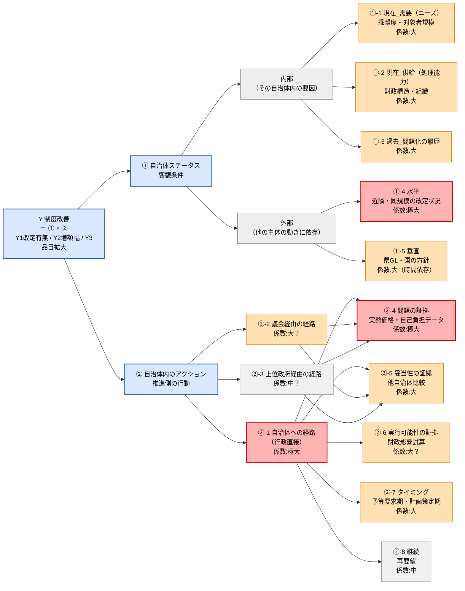

この文書は、自治体がストーマ装具の給付基準額を引き上げる要因を **Y（制度改善）＝①自治体ステータス × ②自治体内のアクション** という方程式に分解し、「何が効くか（What）」と「どうすれば効かせられるか（How＝打ち手）」を仮説として整理したものです。
**使い方**: 確認済み事例からの帰納であり予測モデルではない。PJ2ヒアリングはこの仮説を検証する場として使う。

---

## 全体像

赤＝係数「極大」
橙＝「大」
灰＝「中」。
①は「内部（今の需要・供給＋過去の蓄積）」と「外部（水平・垂直）」に分かれ、
②は「経路（自治体・議会・上位政府）」の先に「内容・時期」がある。
②-4・②-5（問題の証拠・妥当性の証拠）はどの経路からでも使える内容、
②-6〜8（実行可能性・タイミング・継続）は主に自治体への直接経路で使う。

---

## ① 自治体ステータスの各要素

| コード | 要素 | 係数 | 一言 |
|---|---|---|---|
| ①-1 ニーズ | 乖離度・対象者規模（現在の需要） | 大 | 基準額と実勢価格の乖離、造設術率・対象者数。NDBデータでは需要の高さ（造設術率）と基準額の高さは相関しない（都道府県別 r=-0.07〜-0.26、有意でない）→ 需要だけでは動かない |
| ①-2 処理能力 | 財政構造・組織（現在の供給） | 大 | 国・県補助は予算の範囲内の上限あり。常設の検討体制（神戸市）や担当課の受容性（回答書の有無・面談受入れ）が検討の乗りやすさを左右 |
| ①-3 問題化の履歴 | 過去の蓄積 | 大 | 議会での言及実績の蓄積。高い自治体ほど②-1要望・②-4データ提示の効きが良いと推測 |
| ①-4 水平 | 近隣・同規模の改定状況 | 極大 | 最も強いと仮説される変数。参照枠は「県内」ではなく「同格都市群（政令市・中核市同士）」（県下89%改定済みでも動かない大津市が示す事例） |
| ①-5 垂直 | 県GL・国の方針 | 大（時間依存） | 静岡県以外のGL有無は未確認。内閣府の基準額点検（R9予算）は現時点でストーマ・日常生活用具への適用は未確認 |

## ② 自治体内のアクションの各要素

**経路**

| コード           | 経路                | 係数  | 一言                                                                                                  |
| ------------- | ----------------- | --- | --------------------------------------------------------------------------------------------------- |
| ②-1 自治体への経路   | 事前協議 → 首長宛の公式要望   | 極大  | 改定起点が判明している3系統（東京・苫小牧・静岡県GL経由）のうち2系統がこの経路から当事者団体の要望を起点に動いた。要望の回数だけでなく**内容の粒度**（目標額・根拠・対象品目の明示）も効くとみている（H1参照）                                          |
| ②-2 議会経由の経路   | 質問・請願・陳情          | 大？  | 単独では改定を決定づけないが、問題化の履歴（①-3）を高め、後続の②-1・②-4の効きを強める間接効果。福岡市で現在進行中                                       |
| ②-3 上位政府経由の経路 | 県GL策定・見直し、国への働きかけ | 中？  | 1県のGL改定で一括波及する利点はあるが、**大半の都道府県にGLが存在しないと推定**され、働きかけの土台自体が乏しい。静岡県照会・他県GL有無確認で確度を上げたい |

**内容・時期**（主に②-1「自治体への経路」で使う）

| コード | 内容/時期 | 係数 | 一言 |
|---|---|---|---|
| ②-4 問題の証拠 | 実勢価格・自己負担の実態データ | 極大 | 上げ幅を決める最重要因子。当該自治体固有のミクロデータ（販売店の購入実績等）があれば大幅改定（東京・神戸）、全国マクロデータのみだと相場並みの改定に収斂（苫小牧） |
| ②-5 妥当性の証拠 | 他自治体比較・参照額 | 大 | 「うちだけ低い」を可視化する資料。①-4・①-5を担当者に見せる行為 |
| ②-6 実行可能性の証拠 | 財政影響試算 | 大？ | 「財政余力のある自治体を狙え」ではなく「財政インパクトの小ささを示せ」が操作方針 |
| ②-7 タイミング | 予算要求期・計画策定期 | 大 | 要望・データ提出を予算要求期（概ね8〜10月）に合わせる |
| ②-8 継続 | 再要望 | 中 | 苫小牧は初回「個々の環境が異なる」で不調→再要望で改定を実現 |

---

## 仮説 H1〜H7（What→How）

目的は「基準額を上げる・対象を広げるにはどうするか」なので、各What仮説（何が効くかの診断）にHow仮説（十分条件に近づける打ち手）を対応させている。確認済み事例はすべて改定自治体で、未改定自治体との比較を欠くため、必要条件か十分条件かは判別できていない（PJ2ヒアリングで補う）。

新留メモ：要は、「具体的な数値や根拠を持って」「当事者団体や議員、庁内キーパーソンの協力を得て、要望を上げていく」ということか。

| #   | 対象      | What仮説（診断）                                                             | How仮説（打ち手）                                                                                                                                       |
| --- | ------- | ---------------------------------------------------------------------- | ------------------------------------------------------------------------------------------------------------------------------------------------ |
| H1  | ②-1、②-4 | 当事者団体の要望は必要条件だが十分条件ではない（宇都宮7回・鹿児島5回・川口5回・大津4回要望でも未改定。**単純な反復だけでは不十分**）。実勢価格データの粒度は上げ幅（Y2）を決めるが、データ単体では改定有無（Y1）には効かない | 要望書に目標額・算定根拠・対象品目を明示する／実勢価格データ（②-4、当該自治体固有のミクロデータが望ましい）を要望とセットで（単体でなく）同時添付する／事前協議する／再要望のたびに内容を強化する（苫小牧は内容を具体化した再要望で改定に至ったが、1事例のため内容強化と回数のどちらが効いたかは未分離）／要望主体（JOA支部等）自体の確保（松山市は支部消滅） |
| H3  | ①-4     | 大規模市の参照枠は県内ではなく同格都市群（大津市は県下89%改定でも未改定。出典[R2]、回答書原本は未入手）                | 同格都市群でファーストムーバーの改定実績を作り比較資料に使う／比較は同格都市に絞る／複数の同格都市に同時並行でアプローチする                                                                                   |
| H4  | ①-2     | 財政は実際の制約ではなく認知の問題でありうる（「予算不足」回答4市。財政力指数との比較は未実施）                       | 財政影響試算（②-6）を財政課が使える形で示す／「インパクトの小ささ」を訴求する／制度上の制約なら国・県への働きかけに切り替える                                                                                 |
| H5  | ①-5     | 県GL・国の方針は要望の代替になりうるが、大半の県にGLが存在しないと推定される                               | GLがある県はGLに準拠して要望する（静岡県モデル）／GLがない県は自治体への直接要望に集中する                                                                                                 |
| H6  | ①-3×②-2 | 議会で取り上げられただけでは、要望とセットでないと改定されない                                        | 議会質問（②-2）と要望（②-1）を時期的に連動させる                                                                                                                      |
| H7  | ①-2(b)  | 担当課の受容性は検討に乗る確率を上げるが単独では決めない                                           | 勉強会・同行訪問で関係構築する／事前協議で「何があれば通せるか」を要望設計に反映する／受容性は回答書の有無等の観察可能な行動で記録し、主観的な印象評価とは区別する                                                                |

---

## 検証対象10自治体（依頼元提案）※ここは未吟味

| 自治体   | 現状（消/尿）                    | 主に検証する仮説    |
| ----- | -------------------------- | ----------- |
| 盛岡市   | 未改定 8,858/11,639           | H3, H1      |
| 宇都宮市  | 未改定 8,600/11,300（旧標準）      | H1, H4      |
| さいたま市 | **改定済み** R7.4 9,100/12,200 | H1, H3      |
| 川口市   | 未改定 8,858/11,639           | H3, H7      |
| 大津市   | 未改定 8,858/11,639           | H3, H4, H5  |
| 東大阪市  | 未改定 8,858/11,639           | H4, H3      |
| 松山市   | 未改定 8,858/11,639（JOA支部消滅）  | H1, H6, H7  |
| 北九州市  | 未改定 8,900/11,700           | H4          |
| 福岡市   | 未改定 8,900/11,700（増額の噂）     | H6, H1, ①-5 |
| 鹿児島市  | 未改定 8,858/11,639           | H4, H7      |

---

## 次のアクション

1. 実際の要望書の収集
2. 依頼元から入手: 10自治体の回答書原本、水色項目DB（10月納品予定）
3. 静岡県GL原本の情報公開請求（H5検証の前提）

---

## 要確認事項（優先度高いもののみ）

| 事項 | 確認方法 |
|---|---|
| 東京の改定区・未改定区の特定 | 各区市の要綱・予算資料 |
| さいたま市R7.4改定額の一次資料、熊本市・岡山市の改定前後額 | 要綱・予算資料 |
| 回答書原本（大津・東大阪・鹿児島・北九州） | 依頼元から入手 |
| 静岡県GL原本、他46都道府県のGL有無 | 情報公開請求／県Web／ヒアリング |
| 岩手県内の増額2市、滋賀県内の改定市町（89%）の名称 | 依頼元に照会 |
